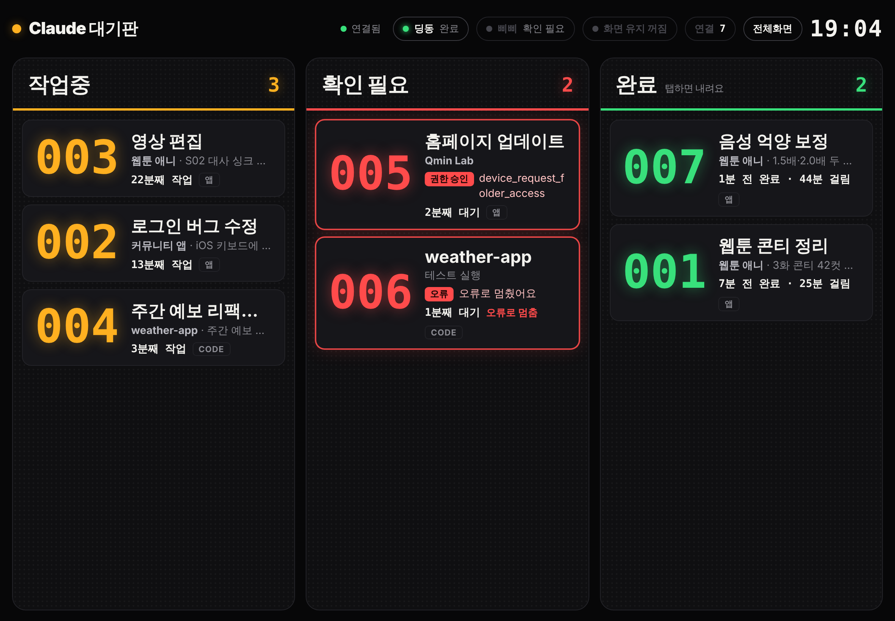
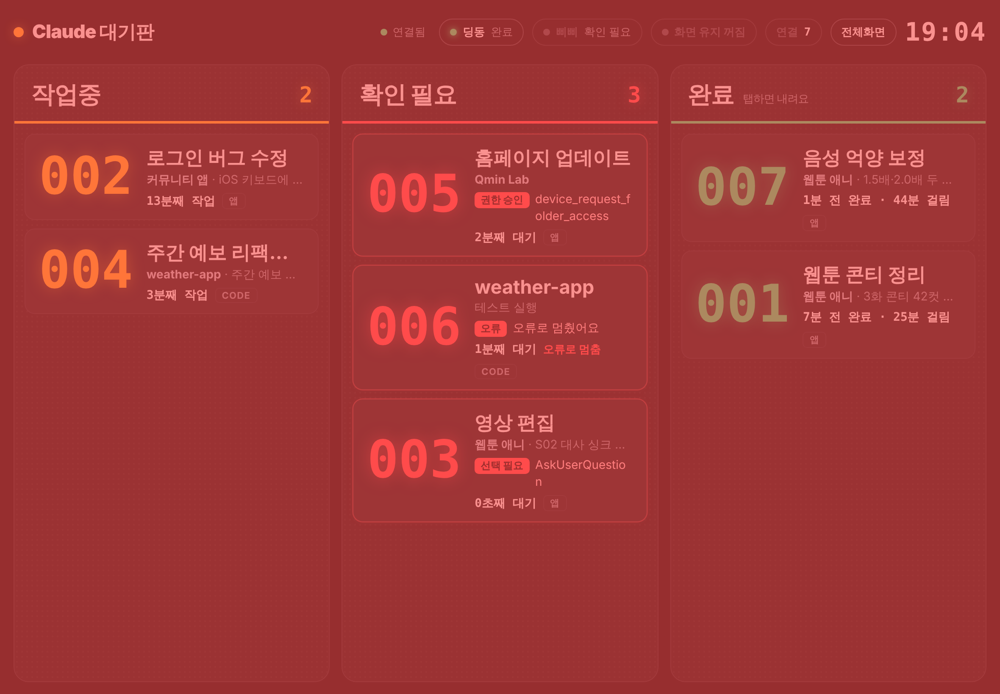
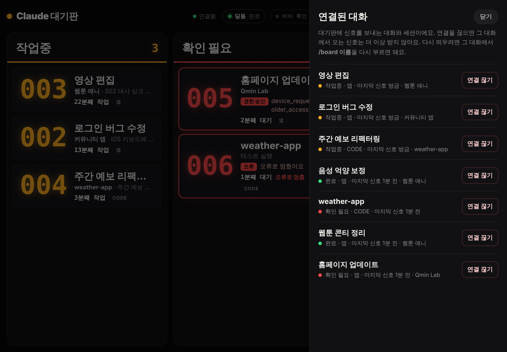
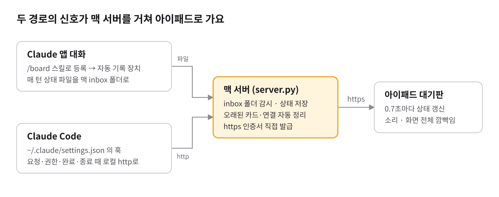
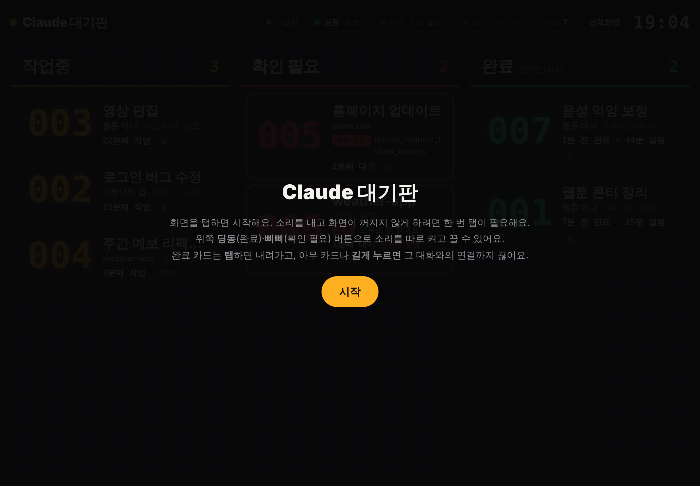

# Claude 대기판

**여러 Claude 작업의 진행 상황을 아이패드 한 화면에 띄우는 작업 현황판**이에요.
패스트푸드점 주문 대기판처럼 작업마다 번호가 붙고, **작업중 · 확인 필요 · 완료** 세 칸을 오가며 실시간으로 바뀌어요.

> **Claude Wait Board** — an iPad status board for every Claude task you have running. Like a pickup board at a fast-food counter, each task gets a number and moves between *Working*, *Needs attention* and *Done* in real time. A tiny Python server on your Mac collects signals from Claude app chats and Claude Code; the iPad shows them, chimes, and flashes the whole screen when something changes.



- 맥에서 도는 서버 하나(Python 표준 라이브러리만 사용, 설치할 패키지 없음)
- 같은 와이파이의 아이패드 Safari에서 보는 화면
- Claude 앱 대화와 Claude Code 양쪽에서 상태를 받아요

---

## 목차

- [왜 만들었나](#왜-만들었나)
- [화면 구성](#화면-구성)
- [알림: 소리와 화면 깜빡임](#알림-소리와-화면-깜빡임)
- [연결 탭](#연결-탭)
- [작동 방식](#작동-방식)
- [상태가 바뀌는 규칙](#상태가-바뀌는-규칙)
- [요구 사항](#요구-사항)
- [설치](#설치)
- [사용법](#사용법)
- [HTTP API](#http-api)
- [보안](#보안)
- [파일 구조](#파일-구조)
- [문제 해결](#문제-해결)
- [한계](#한계)
- [제거](#제거)

---

## 왜 만들었나

Claude에게 일을 맡기면 작업 하나가 몇 분에서 수십 분씩 걸려요. 그래서 여러 대화를 동시에 돌리게 되는데, 그러다 보면 이런 일이 생겨요.

- 어느 대화가 끝났는지 몰라서 대화창을 하나씩 열어 봐야 해요.
- **권한 승인을 기다리며 멈춘 작업**을 한참 뒤에 발견해요. 그동안의 시간은 그냥 버려져요.
- 휴대폰 알림은 다른 알림에 묻히고, 지금 무엇이 몇 분째 돌고 있는지 한눈에 볼 수 없어요.

그래서 책상 위 아이패드에 전용 화면을 띄워 두고, **고개만 돌리면 전체 상황이 보이게** 만들었어요.

---

## 화면 구성

| 칸 | 색 | 뜻 |
|---|---|---|
| **작업중** | 주황 | Claude가 일하고 있어요. 경과 시간이 함께 보여요 (예: `13분째 작업`) |
| **확인 필요** | 빨강 | 작업 도중 사람이 처리해야 진행되는 상태예요. 빨간 딱지에 이유가 붙어요: **권한 승인 · 선택 필요 · 오류 · 중단됨** |
| **완료** | 초록 | 답이 끝났어요. 다음 단계를 묻는 질문으로 끝나도 완료예요 (예: `방금 완료 · 23분 걸림`) |

카드 하나에는 이런 정보가 들어 있어요.

- **번호**: 대화(세션)마다 하루 단위로 `001`부터 붙어요. 같은 대화는 번호가 유지돼요.
- **이름**: 앱 대화는 `/board 이름`으로 정한 이름, Claude Code는 `/rename`으로 정한 세션 이름이에요. 이름이 없으면 git 저장소 폴더 이름이 떠요.
- **메모**: 지금 하는 일 한 줄. 완료 카드에는 결과나 마지막 질문이 보여요.
- **출처**: `앱`(Claude 앱 대화) 또는 `CODE`(Claude Code).

카드가 많아지면 자동으로 촘촘하게 줄어들어요. 한 칸에 9개가 넘으면 `+N개 더`로 접혀요.

---

## 알림: 소리와 화면 깜빡임

다른 곳을 보고 있어도 알아챌 수 있게, 상태가 바뀌면 **화면 전체가 네 번 깜빡여요.**

- 확인 필요가 생기면 **빨강**
- 완료되면 **초록**



소리는 위쪽 버튼으로 종류별로 켜고 꺼요. 사무실에서는 딩동만 켜 두는 식으로 쓰면 돼요. 설정은 아이패드에 저장돼요.

| 버튼 | 소리 | 기본값 |
|---|---|---|
| 딩동 | 완료 칸에 새 카드가 들어올 때 | 켜짐 |
| 삐삐 | 확인 필요 칸에 새 카드가 들어올 때 | 꺼짐 |

> iPad는 사용자가 한 번 화면을 탭해야 소리를 낼 수 있어요. 처음 열면 나오는 **시작** 화면을 탭하면 소리와 화면 유지가 함께 켜져요.

---

## 연결 탭

위쪽 **연결 N** 버튼을 누르면 지금 대기판에 신호를 보내는 대화와 세션 목록이 열려요.



- 대화마다 현재 상태, 출처(앱 / CODE), 마지막 신호 시간이 보여요.
- **연결 끊기**를 두 번 누르면 끊겨요. 끊긴 대화에서 오는 신호는 그 뒤로 무시돼요.
- 다시 띄우려면 그 대화에서 `/board 이름`을 다시 부르면 돼요(새 id로 등록돼요).

---

## 작동 방식



신호는 두 경로로 맥 서버에 모이고, 아이패드가 그 상태를 받아 화면에 그려요.

### 1. Claude 앱 대화 → 자동 기록 장치

Claude 앱(데스크톱) 대화에는 "작업이 시작됐다/끝났다"를 밖으로 알려주는 공식 기능이 없어요. 그래서 대화마다 **자동 기록 장치**를 붙여요.

1. 대화에서 `/board 이름`을 부르면 [`skill/board`](skill/board/SKILL.md) 스킬이 실행돼요.
2. 스킬이 그 대화에 Claude 확장 모드 [`mod/board-live`](mod/board-live/hooks/register.ts)를 설치해요.
3. 사용자가 **Enable for this session**을 한 번 누르면 장치가 켜져요.
4. 그 뒤로 장치가 매 턴 시작·끝, 권한 판정, 도구 실행 끝 같은 순간을 작은 파일로 만들어 맥 연결 도구로 `inbox/` 폴더에 넣어요.

장치(1.0부터)는 **일어난 일만 그대로 보내고, 어느 칸에 둘지는 맥 서버가 정해요.** 그래서 규칙을 바꿀 때는 맥의 `server.py`만 고치면 되고, 서버는 파일이 바뀌면 스스로 다시 시작해서 모든 대화에 바로 적용돼요. 대화마다 장치를 다시 설치할 필요가 없어요.

장치를 켜지 않은 대화는 Claude가 스킬 규칙대로 매 턴 직접 기록하는 예비 방식으로 동작해요.

### 2. Claude Code → 훅

`install.py`가 `~/.claude/settings.json`에 훅을 등록해요. Claude Code가 요청을 받거나, 권한을 묻거나, 답을 끝낼 때마다 `curl`로 맥 서버(`http://127.0.0.1:7777/hook`)에 신호를 보내요. 훅은 백그라운드(`async`)로 돌아서 Claude Code 속도에 영향을 주지 않아요.

### 3. 맥 서버 (`server.py`)

- `inbox/` 폴더를 0.2초마다 확인하고, 들어온 신호로 카드 상태를 바꿔 `state.json`에 저장해요.
- 오래된 카드는 화면에서만 숨겨요: 완료 카드는 1시간 뒤, 신호가 끊긴 카드는 3시간(작업중은 6시간) 뒤. 연결은 그대로 유지돼서, 그 대화에서 새 신호가 오면 카드가 다시 떠요.
- 아이패드용 **https**를 열어요. 맥 안에서 개인 인증기관을 만들고 서버 인증서를 직접 발급해요. 와이파이가 바뀌어 IP가 달라지면 인증서를 새로 만들어요.
- 맥에 로그인하면 `launchd`가 서버를 자동으로 켜고, 꺼지면 다시 켜요.

### 4. 아이패드 (`board.html`)

0.7초마다 서버에 상태를 물어 화면을 다시 그려요. 상태 변화가 생기면 소리와 깜빡임으로 알리고, https에서는 Screen Wake Lock으로 화면이 꺼지지 않게 해요.

---

## 상태가 바뀌는 규칙

**확인 필요는 "작업 도중 막혀서 사람이 처리해야 진행되는 경우"만이에요.** 할 일을 마치고 "다음 단계로 갈까요?"라고 묻는 답이나, 생성 버튼을 직접 누르라는 안내로 끝난 답은 완료예요.

### Claude 앱 대화 (자동 기록 장치)

| 언제 | 상태 | 딱지 |
|---|---|---|
| 메시지를 보내 턴이 시작될 때 | 작업중 | |
| 권한 승인 창이 뜰 때 (웹페이지 가져오기 확인 등, 앱이 "사용자에게 물어봄"으로 판정한 모든 도구) — 같은 작업에서 10초 이상 막혀 있을 때만 | 확인 필요 | 권한 승인 |
| 폴더 접근·컴퓨터 사용 허용을 요청할 때 — 10초 이상 막혀 있을 때만 | 확인 필요 | 권한 승인 |
| 선택지 창(AskUserQuestion)을 띄울 때 — 10초 이상 답이 없을 때만 | 확인 필요 | 선택 필요 |
| 승인·선택 후 다시 일할 때 | 작업중 | |
| 답이 끝났을 때 | 완료 | |
| 응답 도중 사용자가 멈췄을 때 | 확인 필요 | 중단됨 |
| 오류로 끝났을 때 | 확인 필요 | 오류 |
| 세션 종료 신호 (맥락 정리·작업 환경 재시작 때도 옴) | 그대로 둠 — 지운 대화는 신호가 끊겨서 자동 정리 | |

> **미리 "항상 허용"해 둔 도구**는 승인 창 없이 바로 실행되는데, 장치 쪽에서는 그걸 미리 알 수 없어요. 그래서 승인 판정이 나와도 10초 기다려 보고, 그 사이에 실행이 끝나면 확인 필요로 올리지 않아요(잠깐 묻고 바로 넘어가는 경우에 화면이 깜빡이지 않게). 10초 안에 끝난 도구는 "미리 허용됨"으로 기억해 두고(브라우저 도구처럼 같은 묶음은 한꺼번에, 브라우저 도구는 처음부터 미리 허용된 걸로 봐요), 다음부터는 45초까지 기다려요. 그래서 오래 걸리는 명령도 확인 필요로 잘못 가지 않아요.

### Claude Code (훅)

| 훅 이벤트 | 상태 | 딱지 |
|---|---|---|
| `UserPromptSubmit` | 작업중 | |
| `PermissionRequest`, `Notification`(permission_prompt) | 확인 필요 | 권한 승인 |
| `PreToolUse`(AskUserQuestion), `Notification`(elicitation) | 확인 필요 | 선택 필요 / 질문에 답 필요 |
| `PostToolUse`, `PostToolUseFailure`, `PermissionDenied` | 작업중 (확인 필요였을 때) | |
| `Stop` | 완료 | |
| `Notification`(idle_prompt) — 작업중인데 완료 신호 없이 멈췄을 때(Esc 중단 등) | 확인 필요 | 입력 대기 |
| `StopFailure` | 확인 필요 | 오류 |
| `SessionEnd` | 카드 정리 | |

---

## 요구 사항

- **macOS** (서버와 자동 실행)
  - Python 3.8 이상 (`python3`, Xcode Command Line Tools에 포함)
  - `openssl` (macOS 기본 `/usr/bin/openssl`)
- **iPad** — 맥과 같은 와이파이, Safari 권장
- **Claude 앱 대화**를 연결하려면: Claude 데스크톱 앱에서 맥과 연결된 대화
- **Claude Code**를 연결하려면: 맥에 설치된 Claude Code

---

## 설치

### 1. 저장소 받기

```bash
mkdir -p ~/JARVIS && cd ~/JARVIS
git clone https://github.com/starMinK/claude-board.git
cd claude-board
```

> 기본 위치는 `~/JARVIS/claude-board`예요. 다른 곳에 두려면 [`mod/board-live/hooks/register.ts`](mod/board-live/hooks/register.ts)와 [`skill/board/SKILL.md`](skill/board/SKILL.md) 안의 `~/JARVIS/claude-board` 경로를 같이 바꿔 주세요.

### 2. 서버 설치

```bash
python3 install.py
```

이 명령이 하는 일:

1. `~/.claude/settings.json`에 Claude Code 훅을 추가해요. 원래 설정은 그대로 두고, 수정 전에 같은 폴더에 백업(`settings.json.bak-claude-board-날짜`)을 남겨요. 여러 번 실행해도 훅이 중복되지 않아요.
2. `~/Library/LaunchAgents/com.qminlab.claude-board.plist`를 만들어 맥에 로그인할 때마다 서버가 켜지게 하고, 지금 바로 켜요.
3. 처음 실행할 때 https 인증서와 접근 키를 만들고, 마지막에 이렇게 주소를 알려줘요.

```
Claude 대기판 실행 중 → 아이패드에서 http://192.168.0.12:7777/?k=접근키 열기
  https 주소: https://내-맥.local:7443/?k=접근키  (또는 https://192.168.0.12:7443/?k=접근키)
  아이패드 인증서 설치: http://192.168.0.12:7777/ca.crt?k=접근키
```

처음 켤 때 "Python이 들어오는 연결을 허용할까요?" 창이 뜨면 **허용**을 눌러 주세요. 코드를 업데이트한 뒤에도 같은 명령을 다시 실행하면 새 버전으로 다시 켜져요.

### 3. 아이패드 연결 (처음 한 번)

화면 유지(Wake Lock)는 **https에서만** 동작해요. 그래서 아이패드에 맥 서버의 인증서를 한 번 등록해요.

1. Safari로 `인증서 설치` 주소(`http://…:7777/ca.crt?k=…`)를 열고, 프로파일 다운로드를 **허용**해요.
2. 설정 앱 맨 위 **프로파일이 다운로드됨** → **설치**를 눌러요.
3. 설정 → 일반 → 정보 → 맨 아래 **인증서 신뢰 설정** → **Claude Board Local CA**를 켜요.
4. Safari로 **https 주소**를 열어요. `….local`로 시작하는 주소를 쓰면 맥 IP가 바뀌어도 그대로 열려요.
5. 공유 → **홈 화면에 추가**를 누르면 주소창 없는 전체화면 앱처럼 쓸 수 있어요.
6. 처음 뜨는 **시작** 화면을 한 번 탭해요.



> 홈 화면 아이콘에서 화면 유지가 되려면 iPadOS 18.4 이상이 필요해요. 그보다 낮으면 Safari 탭으로 열어 두거나, 설정 → 디스플레이 및 밝기 → 자동 잠금 → **안 함**으로 바꿔 주세요.

### 4-a. Claude 앱 대화 연결

1. [`skill/board`](skill/board) 폴더를 Claude 앱에 스킬로 추가해요.
2. 대기판에 띄우고 싶은 대화에서 이름과 함께 불러요.
   ```
   /board 영상제작
   ```
3. 맥 폴더 접근 허용 창이 뜨면 **허용**, 이어서 **"Enable hot reloading for this session?"** 창이 뜨면 **Enable for this session**을 눌러요.

이제 그 대화는 메시지를 보낼 때마다 자동으로 대기판에 기록돼요. 대화마다 한 번씩만 하면 돼요.

### 4-b. Claude Code 연결

`install.py`가 이미 훅을 등록했어요. 설치 전부터 열려 있던 Claude Code 세션만 다시 시작하면 돼요. 카드에 보일 이름을 정하려면:

```bash
claude -n "주간 예보 리팩터링"   # 시작할 때
/rename 주간 예보 리팩터링       # 세션 안에서
```

---

## 사용법

| 하고 싶은 것 | 방법 |
|---|---|
| 완료 카드 내리기 | 카드를 **탭** (연결은 유지돼요) |
| 대화와의 연결 끊기 | 카드를 **길게 누르기**, 또는 연결 탭에서 **연결 끊기** 두 번 |
| 소리 켜고 끄기 | 위쪽 **딩동** / **삐삐** 버튼 |
| 화면 유지 상태 확인 | 위쪽 **화면 유지** 버튼 (https가 아니면 안내가 떠요) |
| 전체화면 | 위쪽 **전체화면** 버튼, 또는 홈 화면 아이콘으로 열기 |
| 앱 대화 이름 바꾸기 | 그 대화에서 "대기판 이름 ○○로 바꿔줘" |
| 앱 대화 내리기 | 그 대화에서 `/board 끝` |
| 앱 대화의 장치를 최신으로 | 그 대화에서 `/board 업데이트` |

---

## HTTP API

서버는 두 포트를 열어요.

| 포트 | 용도 |
|---|---|
| `7777` (http) | 이 맥의 훅·기록용, 인증서 다운로드 |
| `7443` (https) | 아이패드 화면용 |

| 메서드 · 경로 | 누가 | 설명 |
|---|---|---|
| `GET /` | 접근 키 | 대기판 화면 |
| `GET /state` | 접근 키 | 모든 카드 상태 (JSON) |
| `GET /links` | 접근 키 | 연결 목록 (JSON) |
| `GET /ca.crt` | 접근 키 | 아이패드에 설치할 인증서 |
| `POST /hook` | 이 맥만 | Claude Code 훅 입력을 그대로 받음 |
| `POST /event` | 이 맥만 | 상태 직접 보내기 (아래 형식) |
| `POST /dismiss` | 접근 키 | `{"id"}` 카드만 내림 |
| `POST /disconnect` | 접근 키 | `{"id"}` 카드와 연결을 지우고 이후 신호 무시 |

접근 키는 주소의 `?k=…` 또는 `X-Board-Key` 헤더로 보내요. 맥 자신(`127.0.0.1`)에서 온 요청은 키 없이 통과해요.

### 상태 보내기 형식

`POST /event` 본문이나 `inbox/` 폴더의 `.json` 파일(파일 하나에 객체 하나 또는 배열) 모두 같은 형식이에요.

```json
{
  "id": "abcd1234",
  "title": "영상 편집",
  "project": "웹툰 애니",
  "status": "working",
  "reason": "권한 승인",
  "note": "S02 대사 싱크 맞추기"
}
```

| 필드 | 설명 |
|---|---|
| `id` | 대화를 구분하는 고정 id (필수) |
| `title` | 카드에 크게 보일 이름 |
| `project` | 이름 아래 작게 보일 프로젝트 이름 |
| `status` | `working` · `needs` · `done` · `remove`(카드만 내림) · `ended`(대화 종료) |
| `reason` | `needs`일 때 빨간 딱지에 들어갈 이유 |
| `note` | 한 줄 메모 (`needs`일 때는 딱지 옆 설명) |
| `disconnect` | `remove`와 함께 `true`면 연결까지 끊음 |

테스트:

```bash
curl -X POST localhost:7777/event -H 'Content-Type: application/json' \
  -d '{"id":"test","title":"테스트","status":"working","note":"잘 뜨나요?"}'
curl -X POST localhost:7777/event -H 'Content-Type: application/json' \
  -d '{"id":"test","status":"done"}'
```

---

## 보안

사무실 와이파이처럼 여러 사람이 쓰는 네트워크를 전제로 만들었어요.

- **상태를 바꾸는 요청**(`/hook`, `/event`)은 맥 자신에게서 온 것만 받아요.
- **화면 보기와 카드 내리기**는 비밀 접근 키가 붙은 주소로 연 기기만 할 수 있어요. 같은 와이파이의 다른 사람은 주소를 알아도 키 없이는 못 열어요.
- 접근 키(`key.txt`), 인증서와 개인 키(`certs/`), 상태(`state.json`), 기록(`server.log`)은 `.gitignore`에 들어 있어 저장소에 올라가지 않아요.
- 모든 데이터는 맥과 아이패드 안에만 있고, 외부 서버로 나가지 않아요.
- 접근 키를 바꾸려면 `key.txt`를 지우고 `python3 install.py`를 다시 실행한 뒤, 아이패드에서 새 주소를 열어요.

---

## 파일 구조

```
claude-board/
├── server.py                 # 맥 서버: 상태 관리, http/https, inbox 감시, 인증서 발급
├── board.html                # 아이패드 화면 (HTML·CSS·JS 한 파일)
├── install.py                # Claude Code 훅 등록 + launchd 자동 실행 (--uninstall 로 제거)
├── mod/board-live/           # Claude 앱 대화용 자동 기록 장치 (Claude 확장 모드)
│   ├── .claude-plugin/plugin.json
│   ├── hooks/hooks.json
│   ├── hooks/register.ts     # turn.start / turn.complete / 권한 요청 / session.end 훅
│   └── board.json.example    # 대화별 설정 (id·이름) 예시
├── skill/board/SKILL.md      # /board 스킬: 대화 등록, 장치 설치, 예비 기록 규칙
└── docs/images/              # README 이미지
```

실행하면 생기는 파일(저장소에는 올라가지 않음): `state.json`, `key.txt`, `certs/`, `inbox/`, `server.log`

---

## 문제 해결

<details>
<summary><b>대기판에 아무 카드도 안 떠요</b></summary>

- 카드는 **요청을 보낸 대화**에만 생겨요. 열어만 둔 대화는 안 떠요.
- 앱 대화는 `/board 이름`으로 등록해야 떠요.
- Claude Code는 설치 이후 **새로 연** 세션부터 떠요.
- 서버가 도는지 확인: 맥에서 `curl localhost:7777/state`
</details>

<details>
<summary><b>메시지를 보냈는데 작업중으로 안 바뀌어요</b></summary>

그 대화에 자동 기록 장치가 안 켜져 있는 경우예요. 장치가 생기기 전에 등록했거나, "Enable hot reloading" 창에서 Not now를 누른 대화예요. 그 대화에서 `/board 이름`을 다시 부르고 **Enable for this session**을 눌러 주세요.
</details>

<details>
<summary><b>화면 오른쪽 위에 "주소에 키가 없어요"가 떠요</b></summary>

주소 끝의 `?k=…`가 빠졌어요. 맥에서 `cat ~/JARVIS/claude-board/key.txt`로 키를 확인하고, install.py가 알려준 주소 전체로 다시 열어 주세요.
</details>

<details>
<summary><b>https 주소가 안 열려요 / 화면이 계속 꺼져요</b></summary>

- 인증서 설치 3단계 중 **인증서 신뢰 설정**을 켰는지 확인해 주세요.
- 화면 유지는 https에서만 동작해요. 위쪽 **화면 유지** 버튼을 누르면 지금 상태를 알려줘요.
- iPad Chrome은 화면 유지·전체화면을 지원하지 않아요. Safari를 써 주세요.
</details>

<details>
<summary><b>반응이 몇 초 늦어요</b></summary>

앱 대화의 신호는 Claude 쪽에서 맥까지 파일이 건너가는 데 2~4초가 걸려요. 연결 방식 자체의 시간이라 줄일 수 없어요. Claude Code 신호는 1초 안에 반영돼요.
</details>

<details>
<summary><b>지운 대화의 카드가 남아 있어요</b></summary>

대화가 끝날 때 장치가 종료 신호를 보내지만, 갑자기 꺼지면 못 보낼 수도 있어요. 신호가 3시간 없으면 자동으로 정리되고, 카드를 길게 눌러 바로 끊을 수도 있어요.
</details>

---

### 아이패드에서 이름 바꾸기

연결 탭에서 대화 옆 **이름** 버튼을 누르면 대기판에 보이는 이름을 바꿀 수 있어요. 비우고 저장하면 원래 이름으로 돌아가요. 이 이름은 대화 쪽 이름이 바뀌어도 그대로 유지돼요.

### 확인 필요가 정해지는 방식

1. 장치가 "이 도구는 사용자에게 물어봐야 함"이라는 판정을 보냄 (앱이 미리 허용해 둔 도구도 이 판정은 똑같이 나와요)
2. 서버가 기다려 봄: 처음 보는 도구·실제로 승인 창을 띄운 적 있는 도구는 **10초**, 미리 허용된 걸로 아는 도구는 **180초**
3. 그 사이에 "실행 끝" 신호가 오면 아무 일 없음, 안 오면 확인 필요
4. 장치 1.1부터는 실행 끝 신호에 실제 실행 시간이 같이 와서, "승인을 기다린 시간 = 전체 시간 − 실행 시간"으로 그 도구가 미리 허용된 건지 정확히 배워요

## 한계

- 앱 대화는 Claude 데스크톱 앱에서 맥과 연결된 대화만 기록돼요. 휴대폰에서 연 대화는 기록되지 않아요.
- 자동 기록 장치는 대화마다 한 번 허용해야 켜져요.
- 장치 0.x를 쓰던 대화는 `/board 업데이트`를 한 번 해야 1.0으로 바뀌어요. 그 뒤로는 서버만 고치면 돼요.
- 대화를 지운 순간을 알 수 없어요. 신호가 끊긴 카드는 3시간(작업중이면 6시간) 뒤 화면에서 숨겨지고(연결은 유지), 연결 목록에서는 30일 동안 신호가 없을 때만 정리돼요. 바로 치우려면 카드를 길게 누르면 돼요.
- 맥과 아이패드가 같은 네트워크에 있어야 해요.

---

## 제거

```bash
cd ~/JARVIS/claude-board
python3 install.py --uninstall   # Claude Code 훅과 자동 실행 제거
```

아이패드 인증서는 설정 → 일반 → VPN 및 기기 관리에서 **Claude Board Local CA**를 지우면 돼요.

---

Made by [Qmin Lab](https://qminlab.com) with Claude.
